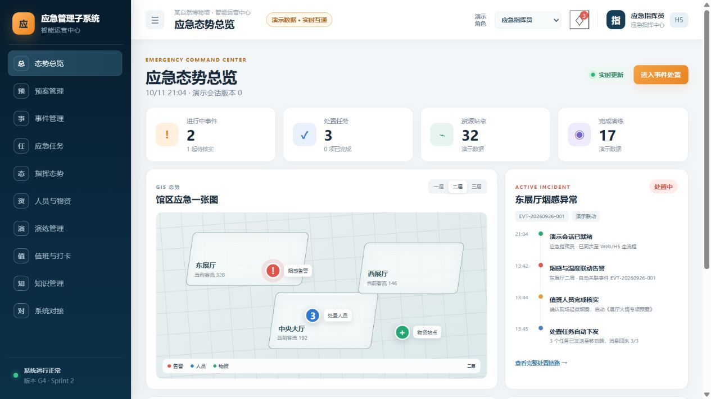
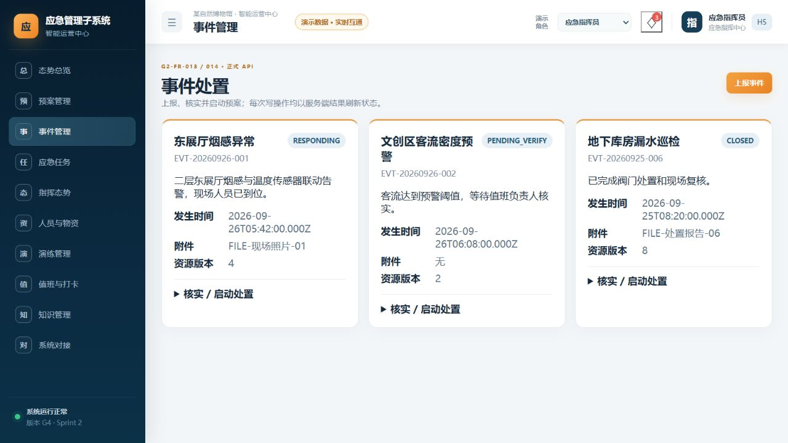
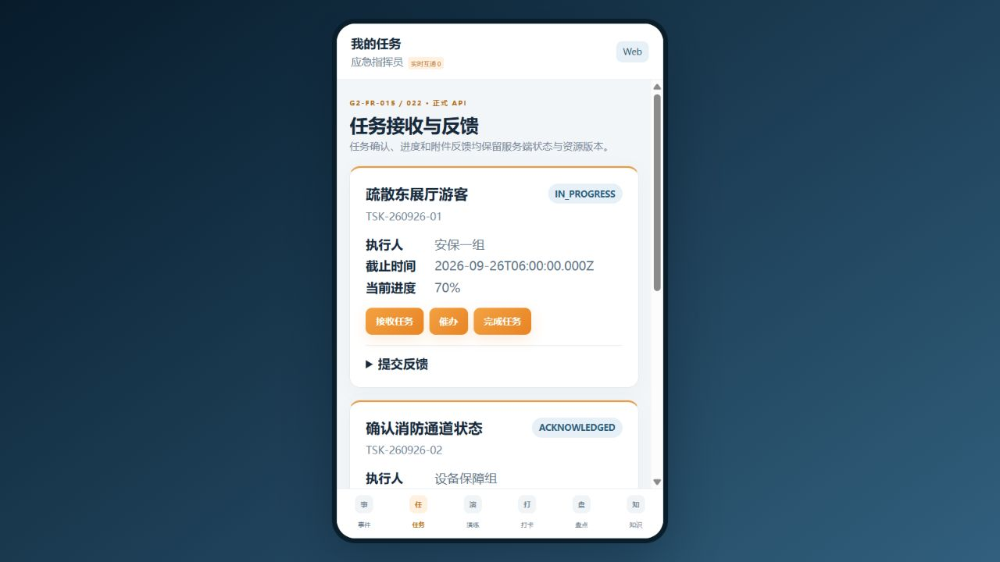

# 某自然博物馆智能运营中心建设项目——应急管理子系统 用户手册

- 文档编号：YJGL-G6-34
- 版本：V0.1
- 状态：REVIEW
- 主责：严宇（B，技术负责人）
- 复核：何思源（A，项目负责人，待复核）
- 发布快照：`beb605f83e738a39dfe388ed4bc25b5b724eddcf`
- 编制日期：2026-10-11

## 1 引言

### 1.1 阅读对象

本手册面向应急指挥员、事件核实人员、现场安保员、任务执行人员、物资保障人员、值班人员和系统管理员。Web 端用于态势查看、事件核实、预案启动、任务统筹和业务台账；H5 嵌入既有智慧管理 APP，用于移动事件上报、任务接收反馈、扫码打卡、物资盘点和知识查询。

### 1.2 系统能做什么

- 通过 Web/H5 上报、查询和核实事件，并在授权后启动已发布预案；
- 生成、下发、接收、反馈、催办和完成应急任务，保存附件引用与资源版本；
- 展示事件、任务、人员、物资、告警和视频引用的态势信息；
- 管理预案、资源、演练、值班、知识和外部接口状态；
- 通过统一中台完成身份、权限和文件能力适配，并保留 traceId、审计与幂等记录；
- 在外部接口超时或失败时显示降级状态，门禁控制失败时转人工处置且禁止自动重放。

### 1.3 当前边界

当前课程候选已经实现 MVP 核心链路及工作台。截图中的橙色“演示数据”标识代表课程展示模式，不是甲方实时数据。视频、消息、定位、GIS、安防和信息发布六类甲方真实系统仍为 `REAL_WORLD_DEFERRED`；不得用演示状态判断生产接口已经联通。生产身份必须使用统一中台 Bearer 令牌，开发身份头只允许在开发模式显式开启。

## 2 快速开始

### 2.1 登录与入口

1. 在既有智慧管理门户完成登录，由门户向系统传递 Bearer 令牌。
2. 打开 Web 根路径，系统进入 `/web/overview`；移动端从宿主 APP 打开 `/h5/events`。
3. 未登录时系统转到“需要登录”；已登录但缺少页面权限时转到“无访问权限”。
4. 登录成功后，右上角显示统一中台返回的显示名；演示模式会额外显示“演示数据”。

图 2-1 应急态势总览（课程演示数据，2026-10-11 实际截图）

### 2.2 页面速查

表 2-1 页面入口与权限速查

| 入口 | 路径 | 主要权限 | 用途 |
| --- | --- | --- | --- |
| 态势总览 | `/web/overview` | `situation:read` | 事件、任务、GIS 态势和系统状态概览 |
| 预案管理 | `/web/plans` | `plan:read` | 预案版本与编排工作台 |
| 事件管理 | `/web/incidents` | `incident:read` | 上报、核实、启动处置 |
| 应急任务 | `/web/tasks` | `task:read` | 临时任务、接收、反馈、催办、完成 |
| 指挥态势 | `/web/situation` | `situation:read` | 事件态势、位置、视频和安防信息 |
| 人员与物资 | `/web/resources` | `resource:read` | 资源台账、盘点和差异 |
| 演练管理 | `/web/drills` | `drill:read` | 演练计划、执行和评估 |
| 值班与打卡 | `/web/duty` | `duty:read` | 值班、点位和到岗情况 |
| 知识管理 | `/web/knowledge` | `knowledge:read` | 应急知识与案例检索 |
| 系统对接 | `/web/integrations` | `integration:read` | 外部端口状态和降级记录 |
| 移动事件/任务 | `/h5/events`、`/h5/tasks` | `incident:read`、`task:read` | 移动上报、接收和反馈 |

## 3 角色与权限

角色由统一中台提供，应用按权限点控制页面和按钮。一个人员可拥有多个角色，最终以返回的权限集合和数据范围为准。

表 3-1 典型角色与操作边界

| 典型角色 | 主要权限点 | 允许操作 | 禁止或受限操作 |
| --- | --- | --- | --- |
| 应急指挥员 | `situation:read`、`incident:read`、`incident:verify`、`incident:start-response`、`task:create`、`task:remind` | 查看全局态势，核实事件，启动预案，统筹任务 | 无授权时不得下发门禁控制或修改他人业务范围 |
| 现场安保员 | `incident:create`、`incident:read`、`task:read`、`task:acknowledge`、`task:feedback`、`task:complete` | 上报事件，接收和反馈任务 | 不得核实事件或启动预案，除非中台另行授予权限 |
| 物资保障员 | `resource:read`、`inventory:write`、`task:read`、`task:feedback` | 查询资源、执行盘点、反馈保障任务 | 盘点调整需经复核，不得直接绕过审批修改快照 |
| 值班人员 | `duty:read`、`attendance:write`、`incident:create` | 查看值班、扫码打卡、上报发现 | 不得查看超出数据范围的事件或任务 |
| 系统管理员 | 中台分配的配置和集成权限 | 配置角色映射、接口参数和受控业务字典 | 不得以管理员身份替代业务审批或删除审计事实 |

## 4 事件上报与核实

### 4.1 上报事件

进入“事件管理”，点击“上报事件”，填写事件类型代码、发生时间、标题和描述。Web 端填写已有文件 ID；H5 可调用中台预签名能力拍照或选择附件。提交成功后系统刷新服务端状态并显示事件编号。重复提交时应复用幂等键，禁止反复点击形成重复事件。

### 4.2 核实事件

具备 `incident:verify` 的人员展开“核实/启动处置”，选择“确认事件”或“驳回”，填写核实说明后提交。页面使用资源版本防止并发覆盖；遇到 409 时重新加载最新状态再决定，不得直接重复原请求。

### 4.3 启动预案

仅对已确认事件输入已发布的预案版本 ID，并填写启动说明。系统按该版本形成快照、任务和消息待发送记录。消息失败不会回滚已提交的业务任务，而会显示待人工复核；不得把“请求已接收”误认为所有外部通道都已送达。

图 4-1 事件处置列表（课程演示数据，2026-10-11 实际截图）

## 5 任务接收、反馈与完成

### 5.1 接收任务

在 H5“我的任务”查看授权范围内任务。点击“接收任务”后，系统提交当前资源版本；成功后状态从待接收进入已接收。若任务已被其他终端处理，页面显示冲突并要求刷新。

### 5.2 反馈进度

展开“提交反馈”，填写文字、0—100 的进度和附件。附件只保存中台文件引用，不在本系统复制文件内容。网络失败时保留输入内容并重试；若显示 traceId，应连同 traceId 和发生时间交给运维。

### 5.3 催办、完成与临时任务

指挥员可在 Web 端催办或创建临时任务；执行人完成前应确认反馈材料齐全。完成操作属于状态变更，不能以浏览器返回撤销；确需更正时由授权人员依据审计记录重新处置。

图 5-1 H5 任务接收与反馈（课程演示数据，2026-10-11 实际截图）

## 6 其他业务工作台

表 6-1 业务工作台操作与降级路径

| 工作台 | 典型操作 | 异常与降级 |
| --- | --- | --- |
| 预案管理 | 查看层级、版本、流程、任务模板和通知对象 | 未发布版本不得用于正式启动；配置变化不反向污染已启动事件快照 |
| 指挥态势 | 切换楼层，查看事件、人员、物资、视频和告警 | GIS 不可用时切换列表/最后有效数据，并显著标识非实时 |
| 人员与物资 | 查询站点、台账、临期和盘点差异 | 盘点保留快照；差异需复核后调整 |
| 演练管理 | 建计划、记录执行、评估和整改 | 取消或未完成必须记录原因，不得改写为完成 |
| 值班与打卡 | 查值班，H5 扫码和位置校验 | 定位源缺失或超时写异常记录，不能伪造到岗 |
| 知识管理 | 按关键字和分类检索预案、案例和指南 | 无结果是正常业务结果；敏感材料服从数据范围 |
| 系统对接 | 查看八类端口及 GIS/H5 状态 | 超时、失败、未授权分开显示；门禁失败只允许人工降级，禁止自动重放 |

## 7 状态、提示与错误处理

表 7-1 页面状态与用户处置

| 页面提示/HTTP | 含义 | 用户处置 |
| --- | --- | --- |
| 需要登录 / 401 | 未建立统一中台身份 | 返回宿主门户重新登录；仍失败则联系中台管理员 |
| 无访问权限 / 403 | 已登录但缺权限或数据范围 | 不更换他人账号；申请授权并提供页面、时间、traceId |
| 404 | 资源不存在或已不在可见范围 | 刷新列表并确认编号；不要手工猜测 URL |
| 409 | 状态、版本或幂等冲突 | 重新加载最新记录，核对后再操作 |
| 422 | 业务规则不满足 | 按页面提示补充必填项或调整状态，不连续重试 |
| 429 | 访问过于频繁 | 停止重复提交，稍后重试 |
| 503 | 中台或外部端口不可用 | 使用页面给出的降级路径；记录 traceId 并通知运维 |
| 加载失败 | 网络、服务或接口异常 | 点击重试一次；持续失败时保留截图、时间和 traceId |

所有错误响应包含 traceId。用户不得粘贴 Bearer 令牌、数据库口令或附件中的敏感信息到问题单。

## 8 演示模式与正式模式

演示模式通过 `npm run demo --prefix frontend` 启动，页面显示“演示数据”，用于课程讲解和界面熟悉；数据保存在浏览器会话中，不构成正式业务记录。正式模式必须连接统一中台和 PostgreSQL，由正式 API Client 读取授权数据。发现页面含“演示数据”时，禁止将截图用于证明甲方接口、生产数据或实时联动已经通过。

## 9 常见问题

表 9-1 常见问题与处理方法

| 现象 | 原因 | 处理 |
| --- | --- | --- |
| 页面跳到“需要登录” | Bearer 缺失、失效或中台不可达 | 从宿主重新登录；运维检查中台地址和身份路径 |
| 能看页面但按钮显示无权限 | 权限集合缺少写权限点 | 联系管理员核对角色映射，不使用开发身份头绕过 |
| 提交后出现 409 | 记录被其他终端更新 | 刷新后按最新资源版本重新决定 |
| 上传附件返回 503 | 中台文件预签名端口不可用 | 保存本地材料，待恢复后重试并保留 traceId |
| 地图/视频为空 | 外部端口未连通或超时 | 使用列表与人工核实；不要把空白解释为无事件 |
| 门禁指令失败 | 既有安全联锁拒绝或接口异常 | 告警并人工降级；禁止系统自动重放控制指令 |
| H5 显示 Web 切换入口 | 当前为独立浏览器课程展示 | 正式交付由宿主 APP 嵌入，发布由甲方负责 |

## 10 术语

表 10-1 术语与定义

| 术语 | 含义 |
| --- | --- |
| 事件 | 需要核实、处置和关闭的应急事实记录 |
| 预案版本 | 经发布、可供事件启动的受控配置版本 |
| 任务 | 由预案或授权人员创建并分配的处置工作 |
| 资源版本 | 用于并发控制的服务端记录版本号 |
| traceId | 贯穿请求、日志和审计的追踪标识 |
| 幂等键 | 防止同一写操作重复执行的请求标识 |
| Outbox | 与业务事实同事务保存的待发送事件记录 |
| `SIMULATED_EVIDENCE` | 模拟或课程证据，不等同甲方真实环境实测 |
| `REAL_WORLD_DEFERRED` | 真实环境尚未执行，必须后续补测 |
